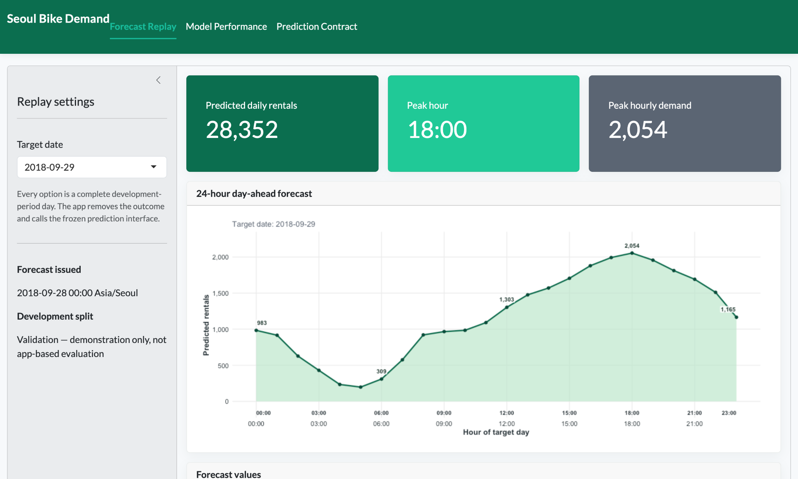
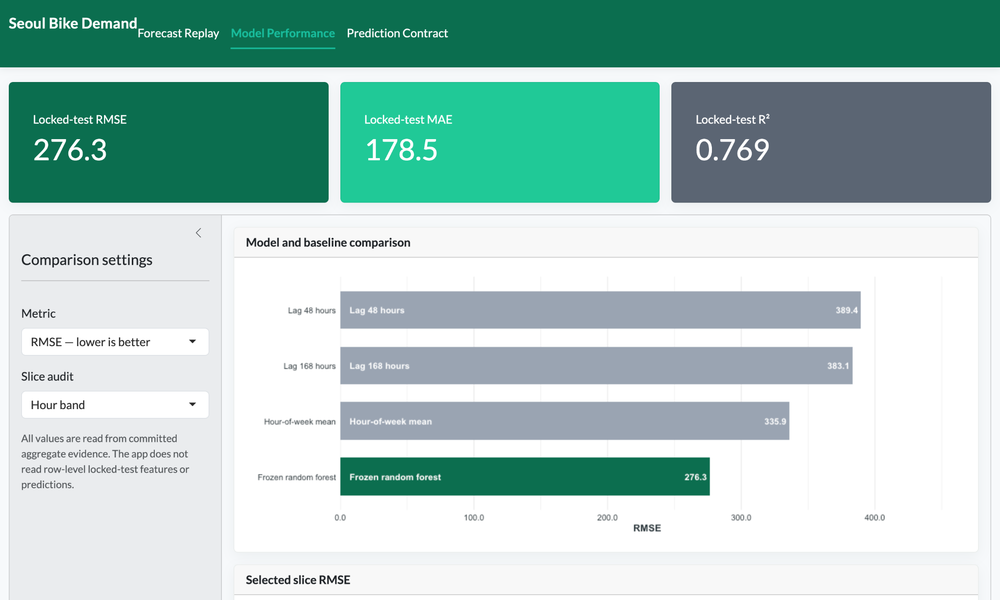
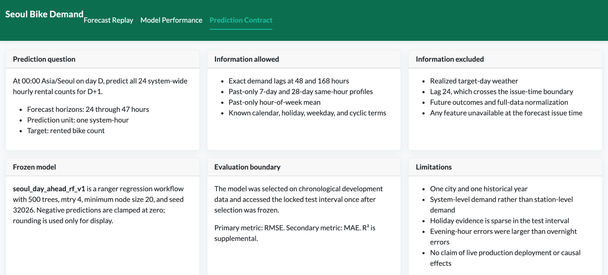
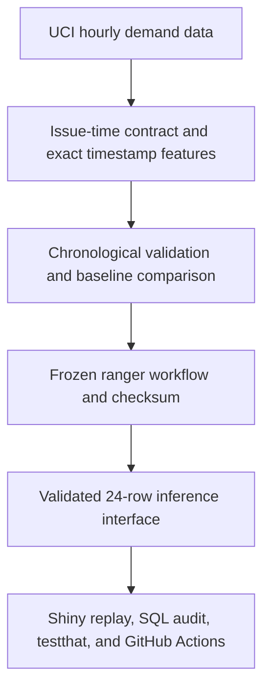

# Seoul Bike Demand: Leakage-Safe Day-Ahead Forecasting in R

[](https://github.com/betteryum/seoul-bike-demand/actions/workflows/phase5_acceptance.yml)

**Author: Youming Li**

An end-to-end R portfolio project that predicts the next day's 24 system-wide hourly bike-rental counts under a strict issue-time contract. The repository combines leakage-safe temporal features, chronological model selection, a frozen `ranger` workflow, a validated inference interface, an interactive Shiny replay, independent SQL audits, automated tests, locked dependencies, and GitHub Actions.

## Project at a glance

| Component | Final implementation |
|---|---|
| Prediction question | At 00:00 `Asia/Seoul` on day D, predict hours 00–23 on D+1 |
| Forecast horizons | 24–47 hours; one output row per system-hour |
| Final model | `seoul_day_ahead_rf_v1`, `ranger` regression, 500 trees, `mtry = 4`, minimum node size 20 |
| Evaluation design | Chronological train/validation/locked-test split; test accessed once after model selection |
| Locked-test performance | RMSE **276.27**, MAE **178.48**, R² **0.769** |
| Baseline comparison | 17.76% lower locked-test RMSE than the past-only hour-of-week mean |
| Reproducibility | R 4.4.1, 114-package `renv.lock`, 12/12 acceptance checks, macOS and Ubuntu CI |
| Application | Three-view Shiny historical replay using outcome-free development inputs and aggregate test evidence |

## Shiny application

The repository contains the complete App in [`app/`](app). It loads the checksum-verified frozen model and calls the same validated prediction interface tested by CI; it does not train a model or read row-level locked-test files.

### Forecast Replay

Select any eligible development-period day and generate a complete 24-hour forecast. The page reports the predicted daily total, peak hour, peak demand, hourly curve, and all 24 forecast values.



### Model Performance

Explore committed aggregate evidence: locked-test RMSE, MAE and R²; the frozen model versus three baselines; hour-band, month and holiday slices; and validation-versus-test results.



### Prediction Contract

Review the forecast timing, allowed and excluded information, frozen-model specification, evaluation boundary, and limitations.



The App passed a separate 14/14 visual review across all three pages, including three replay dates, every performance control, the 24-row table, responsive labels, and absence of browser or R errors. Launch it locally after restoring the locked environment; this is a historical replay, not a live operational forecast service.

## Prediction contract and leakage control

The contract is fixed before modeling:

- The issue timestamp is D at 00:00 in `Asia/Seoul`; the target is the complete day D+1.
- Observed-demand inputs must be strictly earlier than issue time.
- Exact 48- and 168-hour lags are joined by timestamp, never by row offset.
- Past-only predictors include the same-hour 7-day and 28-day means and hour-of-week mean.
- Known calendar inputs include hour, weekday, weekend, holiday, and cyclic time terms.
- Realized target-day weather, future outcomes, full-data normalization, and the unavailable 24-hour lag are excluded.
- Missing dates and partial days are excluded rather than filled with zeros.

The eligible cohort contains 325 complete days and 7,800 hourly rows:

| Split | Date range | Eligible days | Hours | Use |
|---|---|---:|---:|---|
| Train | 2017-12-01 to 2018-07-31 | 230 | 5,520 | Model development |
| Validation | 2018-08-01 to 2018-09-30 | 53 | 1,272 | Chronological selection |
| Locked test | 2018-10-01 to 2018-11-30 | 42 | 1,008 | One final evaluation |

See the frozen [prediction contract](docs/prediction_contract.md) and [split manifest](data/splits/day_ahead_split_manifest.csv).

## Modeling and final results

The selected random forest was refitted on the combined 6,792 train-plus-validation hours after model choice was frozen. Predictions are clamped at zero; evaluation uses continuous values, while rounding is display-only.

| Model | Validation RMSE | Validation MAE | Locked-test RMSE | Locked-test MAE |
|---|---:|---:|---:|---:|
| **Final random forest** | **385.24** | **247.20** | **276.27** | **178.48** |
| Past-only hour-of-week mean | 522.35 | 404.49 | 335.92 | 239.42 |
| Exact 168-hour lag | 547.28 | 314.23 | 383.09 | 226.77 |
| Exact 48-hour lag | 550.40 | 356.51 | 389.42 | 247.01 |

The test period was easier than validation for every compared method, so lower test error is not interpreted as universal future improvement. Aggregate error slices further show that performance varied substantially by time of day:

| Locked-test hour band | Hours | RMSE | MAE | Mean error |
|---|---:|---:|---:|---:|
| 00–05 | 252 | 103.61 | 63.17 | -37.73 |
| 06–11 | 252 | 276.61 | 175.00 | -27.64 |
| 12–17 | 252 | 316.18 | 221.02 | -105.41 |
| 18–23 | 252 | 343.63 | 254.73 | -179.35 |

The single locked-test holiday contributes only 24 observations, so its larger error is descriptive rather than generalizable. Full aggregate results are in the [model card](docs/model_card.md) and frozen CSV evidence under [`artifacts/phase3/final/`](artifacts/phase3/final).

## Engineering and verification



Key engineering work includes:

- Reusable R functions for data loading, exact lags, past-only profiles, baselines, chronological folds, metrics, modeling, and frozen inference.
- A formal inference API that validates predictor names, order, types, ranges, factor levels, issue timestamps, target dates, and one complete 0–23 hour set.
- MD5 verification of the model and all three aggregate evidence tables before acceptance.
- An outcome-free 6,792-row App demo covering 283 development days; the loader rejects outcomes, test rows, schema changes, missing values, or incomplete days.
- Two in-memory SQLite audits: a synthetic missing-hour exact-lag fixture and a 283-day issue-time/complete-day audit.
- Four `testthat` groups covering the contract, inference integration, artifact integrity, and App boundary.
- A read-only GitHub Actions workflow using sparse checkout, R 4.4.1, `renv` restore, prohibited-file checks, SQL audits, and the same 12-check acceptance gate used locally.

The latest audited pre-documentation run, [45925771208](https://github.com/betteryum/seoul-bike-demand/actions/runs/45925771208), succeeded on Ubuntu 24.04.5 at commit `f8f690d8b20be114d098c5d1dc6714071e9b94e6`: the environment was synchronized, all 12 checks passed, all four test groups passed without R/test warnings, frozen hashes were unchanged, and no row-level locked-test data were accessed. The workflow badge reports the current `main` result, including this documentation release.

## Repository structure

```text
.
├── R/                         # feature, baseline, modeling, metric, and inference functions
├── app/                       # three-page Shiny historical replay
│   ├── R/                     # App data boundary and modules
│   ├── data/                  # outcome-free development demo inputs
│   └── www/                   # App styling
├── artifacts/phase3/final/    # frozen model and aggregate evaluation evidence
├── configs/                   # frozen day-ahead contract
├── data/splits/               # chronological eligibility manifest
├── docs/                      # model card, contract, provenance, reproduction, verification
├── scripts/                   # 12-check acceptance gate and SQL runner
├── sql/                       # independent exact-lag and complete-day audits
├── tests/testthat/            # contract, inference, integrity, and App-boundary tests
├── renv.lock                  # 114 locked R packages for R 4.4.1
└── .github/workflows/         # Ubuntu frozen-inference CI
```

## Run locally

From the repository root, use R 4.4.1 and Python 3. These commands restore the exact lockfile, run the complete acceptance gate, and launch the App. They do not retrain or reselect the model.

```sh
Rscript --vanilla -e 'Sys.setenv(RENV_PROJECT = getwd()); source("renv/activate.R"); renv::restore(prompt = FALSE); stopifnot(isTRUE(renv::status(project = getwd())$synchronized))'
Rscript --vanilla -e 'Sys.setenv(RENV_PROJECT = getwd()); source("renv/activate.R"); source("scripts/90_phase5_acceptance.R")'
Rscript --vanilla -e 'Sys.setenv(RENV_PROJECT = getwd()); source("renv/activate.R"); shiny::runApp("app")'
```

Acceptance must report 12/12 `PASS`. See [reproduction](docs/reproduction.md) for generated outputs, verified environments, and troubleshooting boundaries.

## Documentation

- [Model card](docs/model_card.md): frozen model, metrics, slices, intended use, and limitations.
- [Prediction contract](docs/prediction_contract.md): issue time, output schema, feature availability, split, and evaluation rules.
- [Data provenance](docs/data_provenance.md): UCI attribution, license, modeled cohort, and public-data boundary.
- [Reproduction](docs/reproduction.md): exact environment restore, acceptance, and App commands.
- [Verification evidence](docs/verification.md): local and CI evidence, history audit, and frozen hashes.
- [CI sources](docs/ci_sources.md): first-party technical references and sparse-checkout boundary.
- [SQL audit scope](sql/README.md): exact-lag and development-day SQL checks.

## Data provenance and limitations

The source is the [Seoul Bike Sharing Demand dataset](https://archive.ics.uci.edu/dataset/560/seoul+bike+sharing+demand) from UCI: Easwaramoorthy, S. (2020), DOI [10.24432/C5F62R](https://doi.org/10.24432/C5F62R), licensed CC BY 4.0.

The data cover one city and one historical year. Results are system-level, not station-level, and the late-autumn test interval does not establish performance for future years or all seasons. Inventory, events, prices, transit disruptions, and genuine weather forecasts are unavailable. The project demonstrates a reproducible historical forecast contract and inference system; it does not claim live deployment, causal effects, or operational readiness.

This independent portfolio repository was created with a new Git root. Course prompts, graded notebooks, staff code, recovered solutions, private recovery history, and row-level locked-test files are not included.
